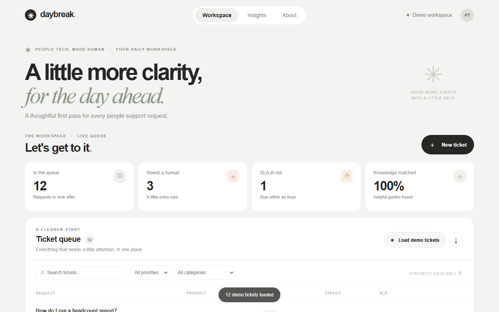

# Daybreak — a calmer start to People Tech support

Daybreak triages a morning queue: it categorizes requests, suggests next steps, surfaces SLA risk, and flags sensitive cases for a person to review.



**Live demo:** Not yet published · **2-minute walkthrough:** Not yet recorded · **Source:** This repository

Open the app, select **Load demo tickets**, and open any ticket to see its reasoning, suggested knowledge article, routing and reply draft. All sample requests are fictional.

## A day in the life

1. **Morning queue:** Load the 12 sample requests and scan priorities, SLA countdowns and the requests marked for human review.
2. **Triage:** Open the LMS login request. Review its Learning category, High priority, four-hour SLA, suggested login article and draft response. Change the ticket status as work progresses.
3. **Escalate:** Open the compensation-letter request. It is Critical and flagged for human review. The app prepares a cautious draft and never sends it or closes the case on its own.
4. **Spot a possible outage:** The sample queue contains one LMS slowness report. Add two similar LMS slowness tickets within 30 minutes; open one of them to see the possible-incident flag. An investigator still needs to verify whether there is an outage.
5. **End of day:** Open Insights for the category breakdown, then use the download button in the queue to export the triage log as CSV.

## Two-minute walkthrough script

- **0:00–0:20:** “This is Daybreak, a synthetic People Technology support queue. It makes a first pass and leaves decisions with the support team.” Load the demo tickets.
- **0:20–0:55:** Open the LMS login ticket. Show category, priority, SLA, the reason, the matching guide and the draft.
- **0:55–1:20:** Open the compensation ticket. Point out the human-review flag and explain that no reply is automatically sent.
- **1:20–1:45:** Add two LMS slowness requests and show the possible-incident flag. Explain that it is a signal to investigate, not a confirmed outage.
- **1:45–2:00:** Show Insights and CSV export. “The queue and decisions are visible, and sensitive work stays with a person.”

## Speaking the ServiceNow language

These are conceptual analogies, not one-to-one implementations:

| Daybreak | ServiceNow concept | Important distinction |
| --- | --- | --- |
| Possible-incident flag | Incident | The flag is a heuristic, not a ServiceNow incident record or a confirmed outage. |
| Queue and suggested group | Assignment group | The demo suggests routing; it does not assign work in ServiceNow. |
| Suggested article | Knowledge base | The demo searches local Markdown articles. |
| Human-review flag | Escalation | The flag requests review; it does not create or manage an escalation. |

This independent demo does not integrate with ServiceNow or claim ServiceNow experience. It was built as proof of work for Cornerstone's People Technology Intern role (req 11869), and is not a Cornerstone product.

## Measuring triage time

No timing comparison has been measured yet. For a meaningful comparison, have a person triage all 12 synthetic tickets manually using a written rubric and a stopwatch, then perform the same work in Daybreak, including reviewing the results. Record the participant, date, task definition, total and per-ticket times, and corrections required. Repeat with the order reversed or different comparable tickets to reduce practice effects. Publish observed results only; the app currently reports no time-savings claim.

## Run locally

```bash
python -m venv .venv
python -m pip install -r requirements.txt
python -m uvicorn app:app --reload
```

Open http://127.0.0.1:8000. Activate the virtual environment first if desired (`.venv\Scripts\activate` on Windows or `source .venv/bin/activate` on macOS/Linux). Python 3.10+ is required. The queue persists in `data/tickets.json`. To reset, stop the server and replace that file's contents with `[]`. The seed button will not overwrite an existing queue.

## Publish the demo

Push the project to a GitHub repository, then create a Render Blueprint from that repository. `render.yaml` defines the free web service. Once Render has deployed it, verify the public URL and replace the live-demo placeholder above. Free hosting can sleep, and the JSON queue is shared, ephemeral and reset on redeploy: **use only synthetic data**. This deployment is a public demo, not a production support system.

## How it works and limits

- Categories, priorities, SLA, routing, knowledge search and confidence are deterministic heuristics; confidence and match scores are not calibrated probabilities.
- The app works without a key. For optional AI-generated drafts on non-sensitive tickets, set `OPENAI_API_KEY`, `OPENAI_MODEL`, and optionally `OPENAI_BASE_URL` to an OpenAI-compatible `/v1` endpoint. If the call fails, the template remains available. Sensitive tickets are not sent to the provider.
- Compensation, absence, payroll and manager-approval cases are flagged for human review. Nothing is automatically sent or resolved.
- CSV export downloads the queue's decision log. SLA countdowns use elapsed hours, not business hours. Incident detection currently covers LMS performance requests only.
- The demo has no authentication, real ServiceNow connection, access controls, production database, or real-time incident monitoring. Do not enter real employee data.

## Sample scenarios

The sample file records expected categories and priorities: LMS login (High), onboarding courses (Medium), leave balance (High, human review), performance review (Medium), candidate workflow (Medium), compensation letter (Critical, human review), video playback (Low), leave approval (High, human review), succession data (Medium), HR Core password reset (Low), LMS slowness (Medium), and headcount reporting (Low).
